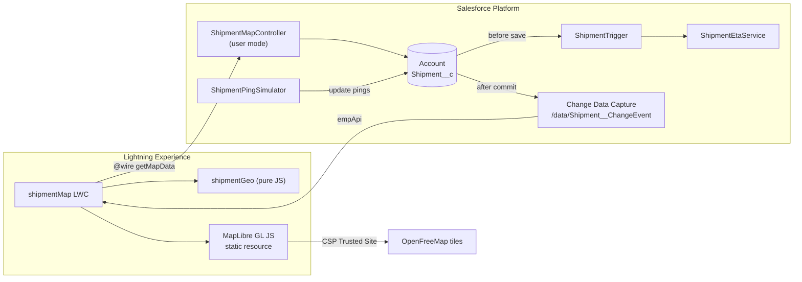

# Salesforce Shipment Tracker

A live freight map built on the Salesforce Platform. Shipments between Accounts are drawn on a
[MapLibre GL JS](https://maplibre.org/) vector map inside a Lightning Web Component, colored by
how likely they are to miss their promised delivery time, and updated in real time as carriers
report new positions.


<!-- Screenshot goes here once the org is set up: docs/screenshot.png -->

## Try the demo without Salesforce

`demo/` is a static page that runs the same map outside Salesforce. It uses the component's own
`shipmentGeo` module, a browser port of the Apex ETA math, and the same demo freight network.
**Play pings** moves the trucks the way `ShipmentPingSimulator` does in the org.

```bash
npm install
npm run demo        # builds demo-dist/ and serves it locally
```

It deploys to Vercel as is: `vercel.json` runs `npm run build:demo` and serves `demo-dist/`.

## What it does

- **Map of the network.** Every geocoded Account is a site. Every Shipment is a pin at its last
  GPS ping, with a solid line for the leg already travelled and a dashed line for the leg
  remaining.
- **Late-risk triage.** On every save, Apex computes remaining distance, an ETA from the mode's
  average speed, and a risk score: **Late** (ETA after the promise), **At Risk** (less than 4 hours
  of slack, or the shipment is Delayed or has an Exception), or **On Time**. The side panel lists
  late freight first, and the chips filter both the list and the map.
- **Live updates.** The component subscribes to Change Data Capture events for `Shipment__c`, so
  when a ping lands (from an integration, a user, or the included simulator), every open map
  refreshes without a page reload.
- **Works on an Account page too.** Drop the component on an Account record page and it shows only
  the freight moving in and out of that Account.
- **Graceful fallback.** If the browser cannot run WebGL or the basemap is blocked, the component
  switches to the standard `lightning-map` with the same data instead of showing a blank card.

## Architecture



| Piece | File | Notes |
| --- | --- | --- |
| Data model | `objects/Shipment__c` | Origin and Destination lookups to Account, a `Location` field for the last ping, computed ETA, risk, and remaining km |
| ETA and risk | `classes/ShipmentEtaService.cls` | `estimate()` is a pure function; `apply()` is the bulk-safe trigger entry point with one query per batch |
| Trigger | `triggers/ShipmentTrigger.trigger` | Thin trigger, logic in `ShipmentTriggerHandler`, recalculates only when an input field changed |
| API | `classes/ShipmentMapController.cls` | `@AuraEnabled(cacheable=true)`, all SOQL `WITH USER_MODE` so sharing and field security apply |
| Demo pings | `classes/ShipmentPingSimulator.cls` | Moves in-transit freight toward its destination; runs from Anonymous Apex or on a schedule |
| Map component | `lwc/shipmentMap` | Loads MapLibre, renders GeoJSON layers, triage panel, CDC subscription, fallback |
| Geo helpers | `lwc/shipmentGeo` | GeoJSON, bounds, sorting, and slack math with no DOM access, fully unit tested |
| Access | `permissionsets/Shipment_Tracker_User` | Object, field, tab, app, and Apex class access in one assignable unit |

### Design decisions

- **MapLibre's CSP build.** The default MapLibre bundle starts its web worker from a Blob URL.
  Lightning's Content Security Policy is strict about that, so the static resource ships the
  `maplibre-gl-csp` build and the component points it at the worker file with `setWorkerUrl()`.
- **Compute on write, not on read.** ETA and risk are stamped by a before-save trigger, so list
  views, reports, and the map all agree, and the map's Apex call stays a cheap read.
- **User mode everywhere a user reads data.** The controller never widens access. The one
  system-mode query reads only Account coordinates for the ETA math and never returns them.
- **Debounced refresh.** A bulk update can fire hundreds of change events. The component
  coalesces them into one `refreshApex` call.
- **No API keys.** The basemap is [OpenFreeMap](https://openfreemap.org/) (OpenStreetMap data),
  so anyone can deploy this to a free org without signing up for a tile provider.

## Run it in a free Developer Edition org

Full walkthrough: [docs/SETUP.md](docs/SETUP.md). The short version:

```bash
npm install --global @salesforce/cli
sf org login web --alias tracker            # log in to your Developer Edition org
sf project deploy start --target-org tracker
sf org assign permset --name Shipment_Tracker_User --target-org tracker
sf apex run --file scripts/apex/seed-demo-data.apex --target-org tracker
sf org open --target-org tracker --path lightning/n/Shipment_Map
```

Then, with the map open in one tab:

```bash
sf apex run --file scripts/apex/simulate-pings.apex --target-org tracker
```

## Tests

```bash
npm install
npm run ci          # ESLint, Prettier, and Jest with coverage thresholds
sf apex run test --test-level RunLocalTests --code-coverage --result-format human --target-org tracker
```

- **Jest:** 30 tests for the component and the geo helpers, with MapLibre, Apex, and empApi mocked.
- **Apex:** tests for the ETA math, bulk trigger behavior (200 records), user-mode access
  including a user without the permission set, Account-page filtering, and the simulator.
- **CI:** GitHub Actions runs lint, format, and Jest on every push. If an `SFDX_AUTH_URL` secret is
  set, it also validates the deploy against an org and runs all Apex tests.

## What I would build next

- Learn average speed per lane and carrier from delivered shipments instead of fixed mode speeds.
- A Platform Event for carrier pings, so integrations publish events instead of updating records.
- Alerting: a Flow that notifies the account owner when a shipment flips to Late.
- Clustering for orgs with thousands of shipments, and road-following routes instead of straight lines.

## License

MIT. MapLibre GL JS is BSD-3-Clause; its license ships with the static resource.
